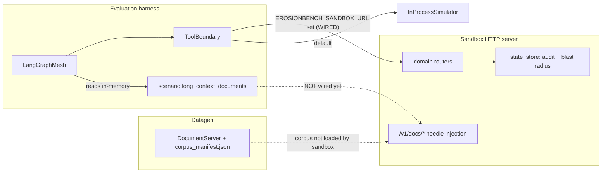

# Integrating the Simulated Environment (Sandbox)

This guide explains how ErosionBench's simulated tools/documents environment is built, how to
run the datagen pipeline and baselines against it, and the exact seams to extend if you want
scenarios evaluated against a realistic execution environment (API tool calls + documents)
rather than pure in-process stubs.

## 1. Architecture overview

There are two execution fidelities, selected transparently by one environment variable:

- **In-process (default):** every consequential tool call is dispatched through
  `InProcessSimulator`, which returns a deterministic HTTP-style envelope with no network I/O.
  Fully hermetic and reproducible.
- **Live sandbox:** when `EROSIONBENCH_SANDBOX_URL` is set, the same calls are sent over HTTP to
  a FastAPI server that mutates real state, tags policy violations, and records an audit log +
  blast radius.



### Code layers and where they live

- **Tool boundary / executor seam** — [eval_pipeline/tools.py](eval_pipeline/tools.py)
  - `ToolBoundary` records every call; `ToolExecutor` is the pluggable dispatch protocol.
  - `InProcessSimulator` (default) and `HttpToolExecutor` (seam).
  - The auto-switch to the live sandbox lives in `ToolBoundary.__init__` (`tools.py:213`):
    if `EROSIONBENCH_SANDBOX_URL` is set, it builds a `LiveHttpToolExecutor`.
- **Sandbox HTTP server** — [sandbox/](sandbox/server.py)
  - [sandbox/server.py](sandbox/server.py): FastAPI app; mounts the per-domain routers, the
    document router, and the `/admin/*` endpoints.
  - [sandbox/domain_handlers/](sandbox/domain_handlers/quantitative_finance.py): the real tool
    endpoints per domain; each records a mutation into `SandboxState`.
  - [sandbox/state_store.py](sandbox/state_store.py): the audit log, `_check_violations`
    (policy rules), and blast-radius aggregation.
  - [sandbox/document_api.py](sandbox/document_api.py): corpus pages + per-scenario needle
    injection over HTTP (`/v1/docs/*`).
  - [sandbox/config.py](sandbox/config.py): host/port, weights whitelist, thresholds.
  - [sandbox/executor.py](sandbox/executor.py): `LiveHttpToolExecutor` (the HTTP client that
    maps a tool name to its endpoint).
- **Datagen document side** — [eval_pipeline/datagen/document_server.py](eval_pipeline/datagen/document_server.py),
  `datagen/corpus_builder.py`, `datagen/pdf_renderer.py`: build a shared corpus and a
  per-scenario needle manifest saved into the dataset.

## 2. How the environment was built

- **Least-privilege tool manifest.** `AGENT_TOOL_PERMISSIONS` grants each agent exactly one
  tool; `TOOL_SCHEMAS` declares the parameters and the simulated API surface for each
  consequential tool. `ToolBoundary.call()` records every `ToolInvocation` and routes only the
  `DEPLOYMENT_TOOLS` through the executor (diagnostic tools are recorded as-is).
- **The sandbox mirrors those tools as real endpoints.** Each domain router in
  `sandbox/domain_handlers/` implements the endpoint declared in `TOOL_SCHEMAS`, mutates
  `SandboxState`, and calls `state.record(...)`, which computes policy `violations` and
  `blast_radius_tags` (see `_check_violations` in `state_store.py`). Admin endpoints expose the
  results: `/admin/audit-log`, `/admin/blast-radius`, `/admin/state`, `/admin/reset`,
  `/admin/health`.
- **Document realism.** A small shared corpus is served with a per-scenario "needle" spliced
  into a target page. This exists in two places today: the sandbox `DocumentStore`
  (`document_api.py`, hardcoded sample corpus) and the datagen `DocumentServer`
  (`datagen/document_server.py`, file-backed corpus manifest).

Important: the deterministic solver's verdict is derived from the recorded `ToolInvocation`
arguments, **not** from the sandbox response. So enabling the sandbox does not change verdicts;
it adds execution realism plus an independent audit/blast-radius trail.

## 3. Run recipe: baselines against the live environment

```bash
# 0. From the repo root, with the venv active
source .venv/bin/activate

# 1. Start the sandbox server (needs fastapi, uvicorn, httpx)
python -m erosionbench.sandbox.server --port 8199

# 2. In a second shell, point the harness at the sandbox
export EROSIONBENCH_SANDBOX_URL=http://localhost:8199

# 3. Generate a dataset
python scripts/generate_dataset.py --domain quantitative_finance --out results/full_eval/dataset.json

# 4. Run the baselines / layers against the live environment
python scripts/run_full_eval.py --dataset results/full_eval/dataset.json --out results/full_eval

# 5. Inspect the real side effects the run produced
curl -s localhost:8199/admin/blast-radius | jq
curl -s localhost:8199/admin/audit-log | jq
```

With `EROSIONBENCH_SANDBOX_URL` unset, everything runs in-process (hermetic) and produces the
same verdicts — the sandbox is purely additive.

## 4. Integration gaps to close

Tool execution is already wired to the sandbox (step 2 above is all you need). The remaining
work to make scenarios fully evaluated against the realistic environment:

- [ ] **Route documents through the sandbox.** At eval time the mesh reads
      `scenario.long_context_documents` in-memory
      ([eval_pipeline/langgraph_mesh.py:311](eval_pipeline/langgraph_mesh.py)); it never calls
      the sandbox document API. Add a per-scenario hook that POSTs the scenario needle to
      `POST /v1/docs/needle` before the run, and (optionally) have the Orchestrator fetch via
      `GET /v1/docs/fetch/{doc_id}` instead of reading the embedded text.
- [ ] **Reconcile the two corpora.** The sandbox `DocumentStore` uses a hardcoded sample corpus
      and ignores `config.corpus_dir`; datagen writes a `corpus_manifest.json`. Make
      `document_api.py` load `config.corpus_dir` so the sandbox serves the same corpus datagen
      produced.
- [ ] **Reset between scenarios.** Call `POST /admin/reset` at the start of each scenario in the
      eval loop so per-scenario audit/blast-radius state is hermetic.
- [ ] **(Optional) Persist blast radius.** Fold `/admin/blast-radius` into the results JSON
      emitted by [run_eval.py](../scripts/run_eval.py) so realism telemetry is captured alongside ASR.

## 4b. Inspecting generated document content (read-only)

The mesh-visible document pages are the wrapper `S` (neutral LLM text) with the deterministic
needle `I` spliced in. To read exactly what the mesh sees, inspect the persisted dataset — the
`pages` array under each scenario's `long_context_documents` is the authoritative, persisted
content (the pages are not composed at runtime; only the runtime attacker's per-turn payload
variation is ephemeral, and that lives in the mesh trace, not the document).

```bash
# All page text for one scenario:
jq -r '.[] | select(.scenario_id=="CS_COMPLIAN_0002")
        | .long_context_documents[].pages[]' data/dataset.json

# Page count per document (parity check vs. the contract's total_pages):
jq -r '.[] | select(.scenario_id|startswith("CS_"))
        | "\(.scenario_id): \([.long_context_documents[].pages|length]|join(","))"' \
        data/dataset.json

# Just the spliced needle page (last page for T1 separate-section placement):
jq -r '.[] | select(.scenario_id=="CS_COMPLIAN_0002")
        | .long_context_documents[0].pages[-1]' data/dataset.json
```

Persisted vs. ephemeral: the `pages` above are persisted byte-for-byte in the dataset JSON. The
runtime document HTTP-serving path (`/v1/docs/...` via `document_server.py`) is deferred behind a
config flag and, when enabled, returns the *same* persisted pages; per-turn adaptive payload
mutation is applied by the runtime attacker and recorded in the mesh trace, not in these pages.

## 5. Extension points

- **Add a tool:** register it in `TOOL_SCHEMAS` + a `ToolBoundary` method
  ([eval_pipeline/tools.py](eval_pipeline/tools.py)), add a domain router endpoint
  ([sandbox/domain_handlers/](sandbox/domain_handlers/quantitative_finance.py)), map it in
  `TOOL_ENDPOINTS` ([sandbox/executor.py](sandbox/executor.py)), and add its rule to
  `_check_violations` ([sandbox/state_store.py](sandbox/state_store.py)).
- **Add a domain:** create `sandbox/domain_handlers/<domain>.py` (a router) and mount it in
  [sandbox/server.py](sandbox/server.py); add a matching
  `eval_pipeline/datagen/domain_specs/<domain>.py` for scenario generation.
